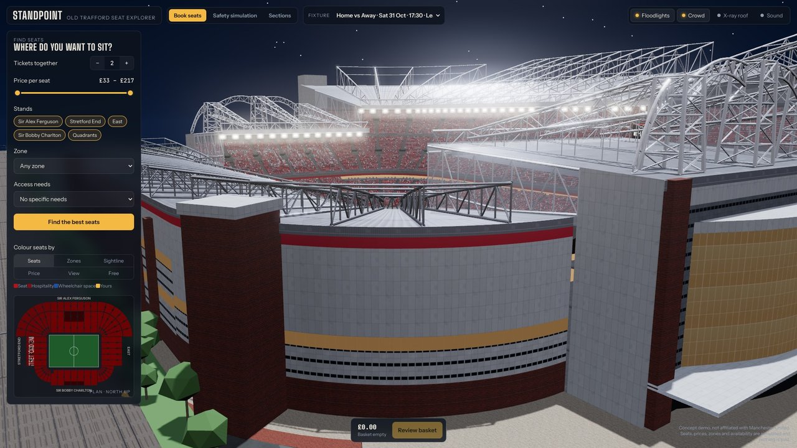
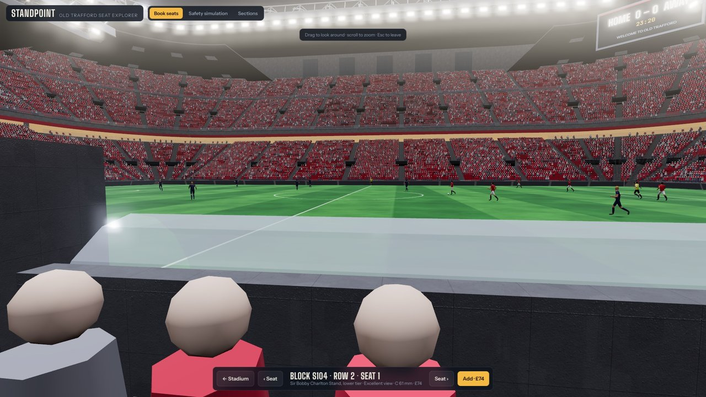
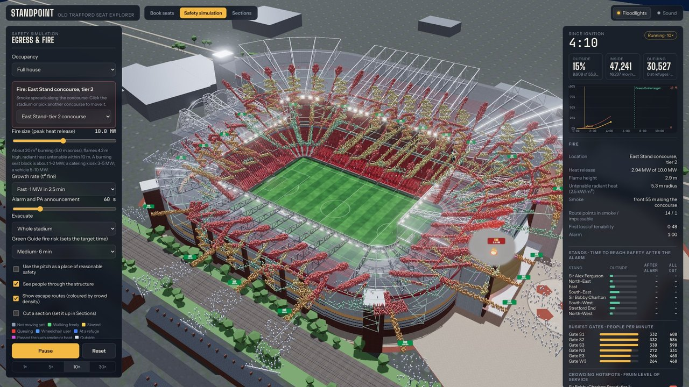
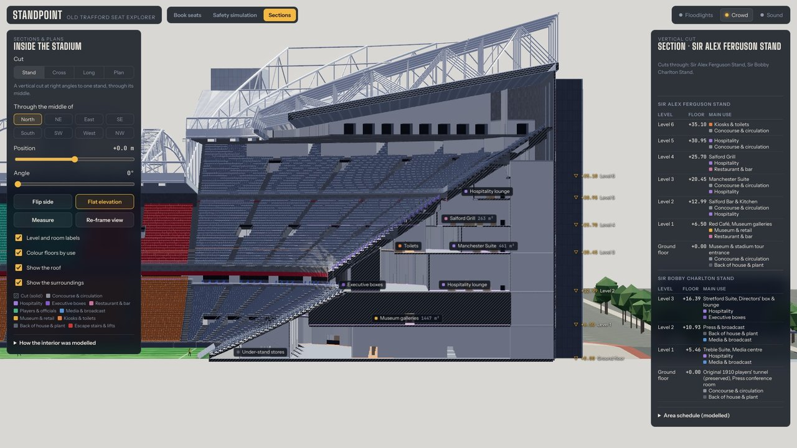

# Stadium Twin: Old Trafford, seat by seat

An interactive 3D model of Old Trafford built from public information, plus a Claude skill that builds the same kind of twin for another stadium.



| Sit in any seat | Fire evacuation | Sections and plans |
|---|---|---|
|  |  |  |

- **Book.** Find seats by tickets, budget, stand, zone and access needs. Every seat has a sightline score (C-value), the real view from that seat, and a first-person "sit here" mode.
- **Evacuate.** Simulate full-time egress or a fire, with smoke spreading along the concourses. Exits close when they become untenable, and a dashboard compares each stand with the UK Green Guide target.
- **Look inside.** Cut sections through any stand, switch to a flat elevation, view floor plans at any level, open room cards, measure, and read an area schedule.

> Concept demo, not affiliated with or endorsed by Manchester United. Seats, prices and availability are simulated. No construction drawings are public, so the interior is an informed reconstruction. The crowd and fire simulation is a teaching model, not a certified fire-engineering study.

## Try it

Live demo: **https://ahmakader.github.io/stadium-twin/**

To host your own copy, fork the repo and turn on GitHub Pages (Settings → Pages → Deploy from branch → `main`, root). The root page forwards to `web/`.

Run it locally. Any static server works; the page can't be opened as a plain file:

```bash
npx serve web            # or: python3 -m http.server -d web 8000
```

## Build it for another stadium (the skill)

`skills/stadium-twin/` is a Claude skill. It runs the whole workflow: research, a facts file, the Blender model, the interior, the simulation, the web app, self-checks and a published link.

1. Download this repo: `git clone https://github.com/ahmakader/stadium-twin` or Code → Download ZIP.
2. Add the skill to Claude:
   - **Claude app:** zip the `skills/stadium-twin` folder and upload it under your skills settings.
   - **Claude Code:** copy the folder to `.claude/skills/stadium-twin` in your project, or to `~/.claude/skills/`.
3. Ask: *"Build a stadium twin of Signal Iduna Park."*

The skill shows its sources and the values it had to guess. Correct `facts.json` and run it again. Expect the first pass to need a round of corrections.

## Rebuild Old Trafford from source

The model is generated by code; nothing is hand-modelled. You need Python 3.11+ and Node 18+.

```bash
pip install bpy shapely numpy pillow     # Blender as a Python module, no Blender app needed
./build.sh                               # textures -> model -> web/v2 assets
```

| Folder | What it does |
|---|---|
| `blender/build_v2.py` | Builds the bowl, roofs, facades, 55,849 seats (the official capacity is 74,158: the Stretford End and East Stand come out too small, about 6,500 seats each against roughly 12,000+ in reality), sightline data, zones and accessibility. The stadium-specific inputs are at the top: `A, B, R` (pitch-side outline), `TIER_SPEC`, `ROOFS` and `SEGS` (stands). |
| `blender/interior.py` | Derives the inside from the bowl: levels, concourses, rooms, stair cores (Green Guide sizing) and the players' tunnel. |
| `blender/egress_net.py` | Turns aisles, vomitories, concourses, stairs and gates into the escape network. |
| `blender/textures2.py` | Generates every texture procedurally (original, no third-party images). |
| `sim/sim.js` | The crowd and fire engine, the same code the page runs. `node sim/simtest.js egress` runs it headless. |
| `web/index.html` | The three.js app: booking, safety simulation and sections. |

### Numbers from this model
- **Full-house egress:** 99 % of people outside after 13:34.
- **10 MW fire in the East Stand concourse** (fast growth, whole stadium evacuated): 95 % outside after 17:40. 99 % takes 34:03, because about 1,000 people are still queuing inside after 30 minutes. That bottleneck is worth investigating.
- **Median C-value:** 60 mm in the lower tiers. The upper tiers come out lower (29 mm and 15 mm) because the rake is capped at the Green Guide maximum of 34°. That is the next thing to improve.

## How it was made
- Claude wrote and ran every script in a cloud workspace. Nothing was installed on the author's computer.
- Blender ran headless through the `bpy` module.
- Proportions were checked against public photos, satellite imagery and a reference model. The reference model is not included, and no geometry from it is in this repo.
- The project was inspired by the StadiView demo. No StadiView code is used.

## Licence
MIT for the code and generated assets (see `LICENSE`). Third-party notices are in `NOTICE.md`. Club names are used only to describe the real building; there are no crests or kits.
